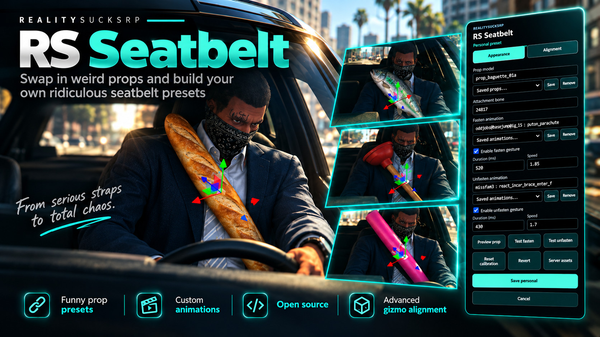
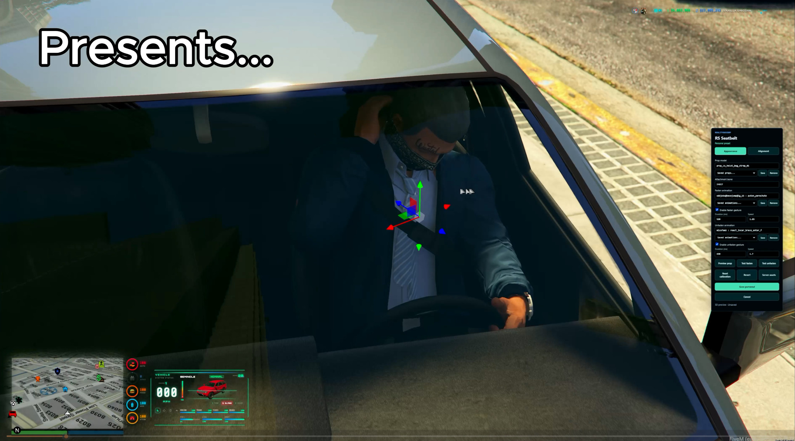

# RS Seatbelt

A FiveM seatbelt and harness with live strap alignment, player presets, and server-wide defaults. Derived from Qbox-project/qbx_seatbelt.

[Download ZIP](https://github.com/RealitySucksRP/rs-seatbelt/releases/latest/download/rs-seatbelt.zip) · [GitHub](https://github.com/RealitySucksRP/rs-seatbelt) · [Website](https://realitysucksrp.github.io/) · [Store](https://reality-sucks-rp-webstore.tebex.io/) · [Discord](https://discord.gg/e9V3rPHySx) · [YouTube](https://www.youtube.com/@RealitySucksRP) · [Free scripts](https://reality-sucks-rp-webstore.tebex.io/category/free-scripts)

Stop any other seatbelt controller, including qbx_seatbelt, before enabling RS Seatbelt. Keep your profiles and calibration when upgrading.

[Package documentation](PACKAGE-README.md) · [Installation](INSTALL.md) · [Changelog](CHANGELOG.md)
