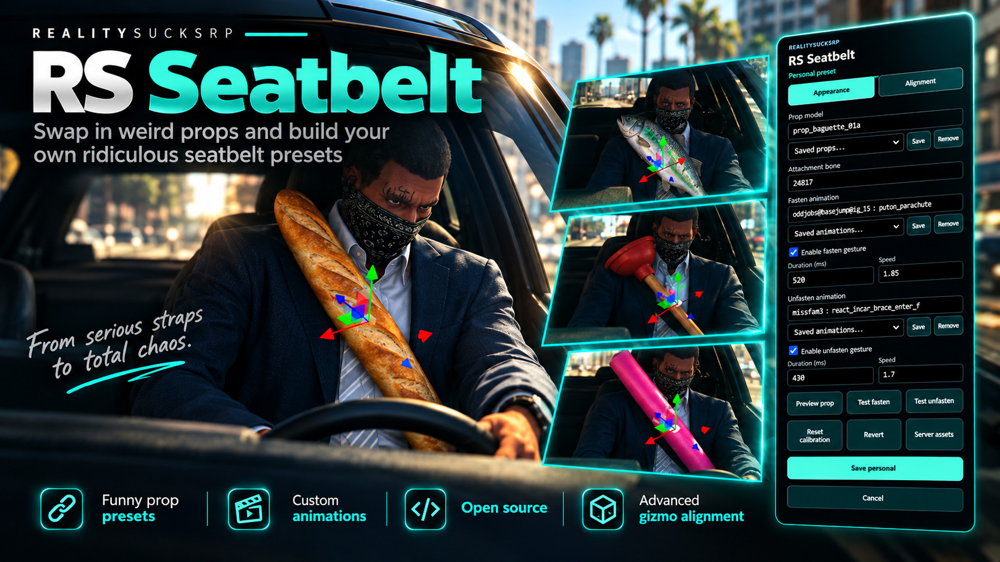
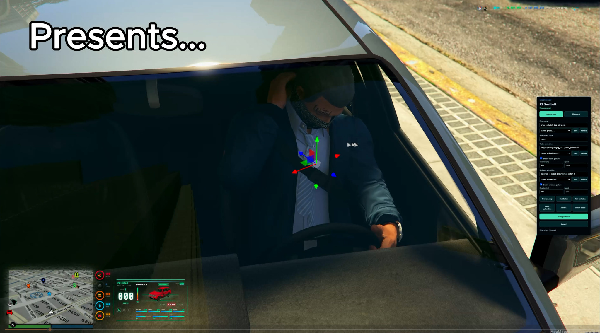
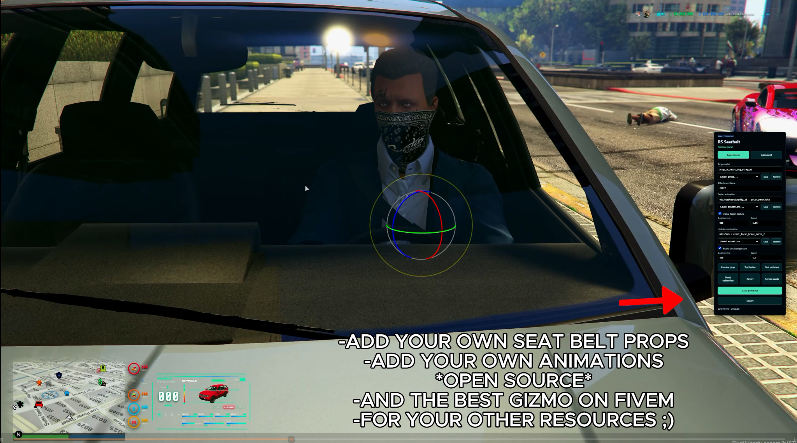
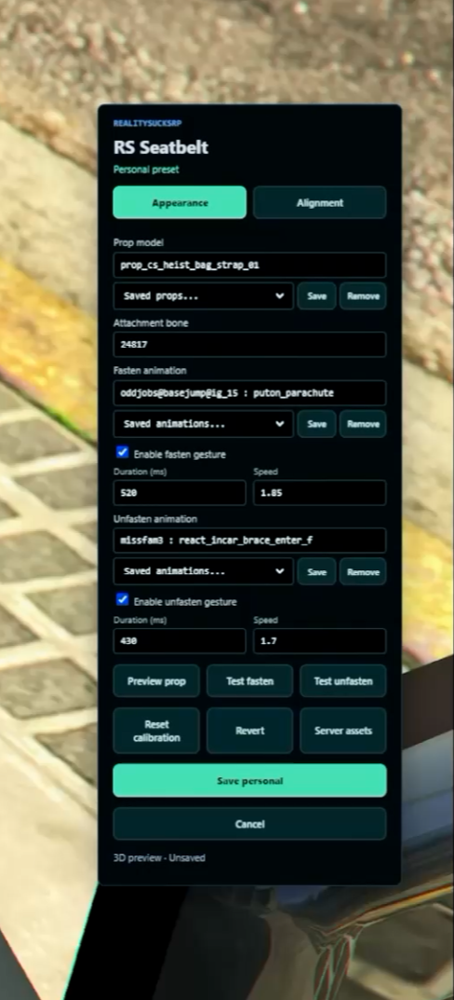
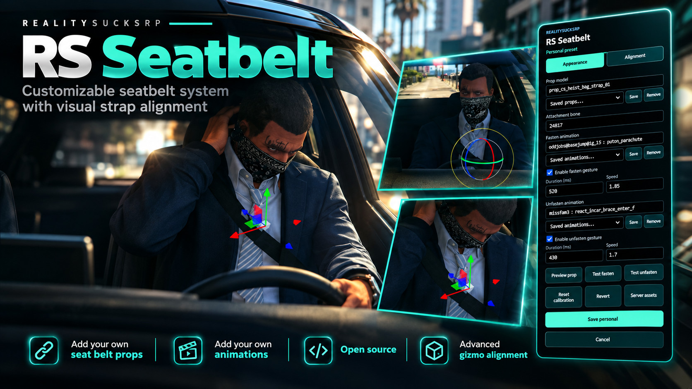

# RS Seatbelt — RealitySucksRP



**A customizable seatbelt, visual strap and racing-harness system for FiveM.** Give players a visible seatbelt, create your own prop and animation presets, and adjust the attachment on your actual character with an in-game 3D gizmo.

**Full source • No escrow • Qbox / QBCore / ESX • GTA V FiveM**

## Features

- **Custom visible seatbelt props:** Choose available GTA/FiveM prop models and save them as personal or server-wide presets. Fine-tune prop attachment position and rotation without restarting.
- **Live 3D alignment studio:** Three-axis gizmo, local/world rotation, numeric adjustments, orbit camera and in-game preview. Use `/rsbelt` or `/rsbeltalign` while seated and buckled.
- **Custom animations:** Separate fastening and unfastening gestures, editable dictionary/clip, duration and playback speed, plus reusable animation presets.
- **Seatbelt reminders:** Default **B** keybind, buckle/unbuckle audio, and configurable seatbelt reminder icon and chimes.
- **Crash ejection thresholds:** Native windshield ejection logic with configurable minimum speeds for unbuckled, buckled and harness-equipped players. Ejection is a *collision* behavior, not automatic at the speed threshold.
- **Racing harness:** Inventory-integrated harness with cancellable progress and server-side item/durability checks.
- **Synced cosmetic appearance:** Nearby OneSync players see the currently saved belt appearance via locally rendered attachments.
- **Character and owner presets:** JSON storage by default, optional oxmysql, ACE-protected server defaults and per-player customization policy.

### Real in-game editor and alignment screenshots

<table>
<tr><td align="center"></td><td align="center"></td></tr>
<tr><td align="center">Live placement and movement</td><td align="center">Rotation controls and saved offsets</td></tr>
</table>

<details><summary>View the editor close-up and the original hero image</summary>





</details>

> **About the promotional images:** The hero showcases creative prop ideas. The illustrated baguette, fish, plunger and pool noodle are visual examples, **not preinstalled models or guaranteed GTA/FiveM prop names**. Players can select only prop assets actually present in GTA or streamed by their server. The gameplay screenshots show the real alignment editor in use.

## Quick installation

1. Install this folder as `resources/[your-folder]/rs-seatbelt` (the resource folder must be named `rs-seatbelt`).
2. Ensure `ox_lib`, a supported framework, and compatible inventory start before `rs-seatbelt`.
3. Disable other seatbelt controllers (including `qbx_seatbelt` or a HUD's built-in controller).
4. Start the resource. RS Seatbelt already enables the replicated native windshield-ejection convar in `server/main.lua`; you can also declare it explicitly in `server.cfg`:

```cfg
setr game_enableFlyThroughWindscreen true
ensure rs-seatbelt
add_ace group.admin rs-seatbelt.admin allow
```

5. Configure `config/server.lua` and `config/client.lua`, and define the `harness` item in your supported inventory. Use **[INSTALL.md](INSTALL.md)** for framework-specific instructions and upgrades.

The default B bind is remappable from FiveM keybind settings. The harness requires `ox_lib` progress support. OneSync is required for multiplayer visual synchronization. **Standalone is not supported.**

## Links and support

- **Tebex store:** https://reality-sucks-rp-webstore.tebex.io/
- **Complete RP and Zombie server packages (321+ resources):** https://realitysucksrp.github.io/
- **More free resources on GitHub:** https://github.com/RealitySucksRP?tab=repositories
- **Discord community and support:** https://discord.gg/e9V3rPHySx
- **YouTube channel:** https://www.youtube.com/@realitysucksrp

## Source license

RS Seatbelt is a full-source derivative of [Qbox-project/qbx_seatbelt](https://github.com/Qbox-project/qbx_seatbelt) and retains its **GNU GPLv3 license**. Anyone receiving a copy retains the rights granted by GPLv3, including modification and redistribution. Third-party Three.js notices are preserved in [THIRD_PARTY_NOTICES.md](THIRD_PARTY_NOTICES.md). The store does not imply a proprietary or anti-redistribution license.

---

## Technical documentation

RealitySucksRP seatbelt and harness with live prop/animation editing, Three.js alignment,
personal character presets, and an owner-published server default.
Derived from Qbox-project/qbx_seatbelt; GPLv3 retained in LICENSE. Bundled Three.js is MIT;
see THIRD_PARTY_NOTICES.md. Renaming this fork does not remove upstream attribution.

## Install

1. Use the folder name `rs-seatbelt`. Stop/remove any other belt controller, including
   `qbx_seatbelt`. Never run two controllers together.
2. Start `ox_lib`, your framework (`qbx_core`, `qb-core`, or `es_extended`), and inventory first.
3. Add `ensure rs-seatbelt` and `add_ace group.admin rs-seatbelt.admin allow` to server.cfg.
4. `config/server.lua` selects framework/inventory (automatic by default), policy, and storage.
   `config/client.lua` retains B key, sounds, HUD icon, warning and crash thresholds.
5. If another resource (such as a Qbox radial menu) calls
   `exports.qbx_seatbelt:HasHarness()`, change that integration to use
   `LocalPlayer.state.harness == true` or `exports['rs-seatbelt']:HasHarness()`.
   RS Seatbelt does not edit other resources automatically.

## Owner Control

Set `personalMode` in `config/server.lua`, then restart the resource:

| Mode | Player control | Owner control |
| --- | --- | --- |
| `server` | Server default only | Full editor and publish |
| `alignment` | Six-axis personal fit only | Full editor and publish |
| `full` | Personal prop, bone, animations and fit | Full editor and publish |

Optional `allowedModels` and `allowedDictionaries` lists restrict personal assets in full
mode. Empty lists allow valid names. Server validation enforces these restrictions and
ACE permission on every save. Owners can always publish a default, independently of
personal-save permission. Existing full personal presets take precedence over new defaults;
use server mode to enforce a single look. Alignment mode merges personal offsets with
the latest server assets. Policy/allowlist changes take effect after resource restart.

## Live Studio

Enter a supported car, buckle with B, then use `/rsbelt` or `/rsbeltalign`.

- Enter a streamed prop model and a bone ID (common bones are offered by the input).
- Paste each animation into one box as `dictionary : clip`, for example
  `oddjobs@basejump@ig_15 : puton_parachute`. Fasten and unfasten have separate boxes.
- Preview prop validates and loads the model/animation clips. Invalid assets leave the
  existing prop intact. Vehicle/ped models are rejected as belt props.
- Test fasten / Test unfasten runs the gesture on your actual seated character.
  Upper-body/secondary flags are fixed to 48; a valid clip is not necessarily seated-compatible.
- Drag XYZ gizmos; W moves, R rotates, Q changes local/world space. Right-drag orbits,
  middle-drag pans, wheel zooms. Numeric controls provide 1 mm / 0.5 degree precision.
- Save personal writes your prop, animations and current calibration together. Publish default requires owner ACE.
- Changing props or animation dictionaries keeps all six calibration values. Server assets
  loads only the server prop/gestures, preserving your calibration and selected bone.
- Reset calibration is the only shortcut that resets placement to the initial fit; it does
  not change the selected prop or animations. Save to keep the reset, or Revert to undo it.
- Revert restores the preset from opening.
  Cancel, vehicle exit, death and resource stop clean up the camera/preview without saving.

### Saved Props And Animations

The Appearance tab has a saved-prop dropdown and saved-animation dropdowns next to both
gestures. Enter a prop or `dictionary : clip`, then click its adjacent Save button.
An animation entry includes its duration, speed and enabled setting. The same animation
library can be used for fastening or unfastening. Select an entry to preview it with the
current calibration; the saved entry never contains or replaces placement offsets.

Players save to My library. Owners can select My library or Server library; shared library
edits require the admin ACE. Server library entries are available to everyone permitted
to customize assets. Remove deletes only the selected library entry, never the active
prop/animation or calibration. Libraries hold up to 32 props and 32 animations per scope;
saving the same model or dictionary/clip updates its existing entry instead of duplicating it.
Personal asset libraries are editable in full mode; alignment-only players keep owner assets.

Saving an entry is separate from Save personal / Publish default: a library is a reusable
collection, not an automatic change to the saved active preset. After selecting a different
entry, use Save personal / Publish default to keep that selection across reconnects.

Unsaved preview props and offsets are local only. Other players see only the saved effective
preset through local cosmetic attachments. Cosmetics never decide inventory authority or crash
protection. Props/animations must exist in GTA or already be streamed by another running resource.
This editor does not upload new model/animation files. Offset limits remain +/-0.35 m.

## Persistence

Default: `storage = 'json'`. `data/profiles.json` stores a versioned map, one preset per
character, plus `__server__`, `library:<character>` collections and `__library__` for shared
assets. Character keys use Qbox/QBCore citizen IDs or ESX's character
identifier, resolved on the server. Numeric player source IDs are never persistence keys.
The previous JSON is backed up to `data/profiles.json.bak` before each write. Invalid JSON
stops profile storage from accepting writes rather than silently overwriting it.

For SQL: import `sql/install.sql`, start `oxmysql` first, set `storage = 'sql'`, restart.
The `rs_seatbelt_profiles` table has character-profile, personal-library, server-default
and shared-library rows, using the same schema. No additional SQL import is needed for libraries.
Queries use parameters. SQL failures are reported, with no silent switch to JSON.
Switching backends does not automatically migrate personal presets; export/import them
before switching on an established server. No database import is needed in JSON mode.

The owner's existing `data/seatbelt_alignment.json` is imported only when the selected
backend has no saved server default. The legacy file is preserved, not rewritten.
Back up all `data/` before updates. Never replace live profile files with release templates.

## Harness Adapters

- Qbox + ox_inventory: usable `harness`, per-slot metadata durability, 5 wear per equip.
- QBCore + qb-inventory: usable item and per-slot `info.durability`, same wear behavior.
- ESX + native inventory: usable item; one harness consumed per equip (no per-slot metadata).
- All three can use ox_inventory for per-slot harness durability. With ESX + ox_inventory,
  define the item's server export as shown below so the actual slot reaches the resource.

```lua
['harness'] = {
    label = 'Harness', weight = 200, consume = 0,
    server = { export = 'rs-seatbelt.useHarness' }
}
```

Existing Qbox usable-item registration is retained, with no change to this server's harness
definition. Define the harness item in your inventory before use. Equip requests require
a server-issued use session, elapsed equip time, same character/vehicle and the correct
inventory item. Cancelled/unconfirmed requests do not enable harness protection.

## Compatibility And Validation

Public compatibility: `state.seatbelt`, `state.harness`, `seatbelt:client:ToggleSeatbelt`,
and `exports['rs-seatbelt']:HasHarness()` remain available. `ox_lib` is required on all
frameworks for cache, keybind, locale and progress support. No qbx client library is imported.

Static, simulated-provider and browser checks are not in-game signoff. Verify after activation:
audio, icon, B toggle, harness wear/cancel, camera/gizmo, new prop/clip validation, save/reconnect,
server restart, character switching and two-player cosmetic synchronization. QBCore/ESX need
their own real server/inventory acceptance tests. Legacy and Enhanced both require
separate in-game verification; no platform-specific runtime test is included with this ZIP.
Standalone is not supported by this framework/inventory implementation.

## Distribution and Updates

This is a GPLv3-derived, full-source resource. A fee may be charged for distribution, but
recipients retain the redistribution, source-access and modification rights granted by GPLv3.
Do not add conflicting anti-redistribution language or promise exclusive code ownership.
Keep LICENSE, upstream attribution and THIRD_PARTY_NOTICES.md in every distribution.

Release packages contain a clean `data/profiles.json` template, not private character
records. When updating an existing installation, **do not overwrite** your server's
`data/profiles.json`, `data/profiles.json.bak`, or calibrated alignment files. The provided
patch package contains code/docs only and is the safer update path for an active server.
Verify any bundled audio's provenance before commercial publication.
